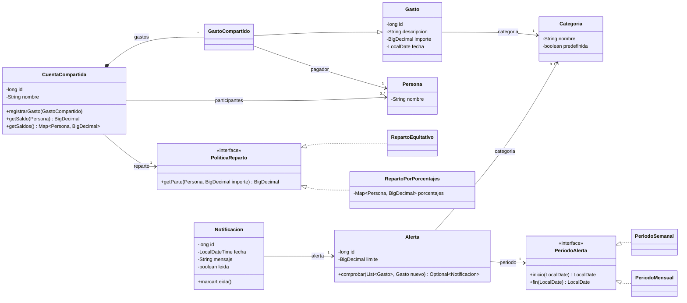
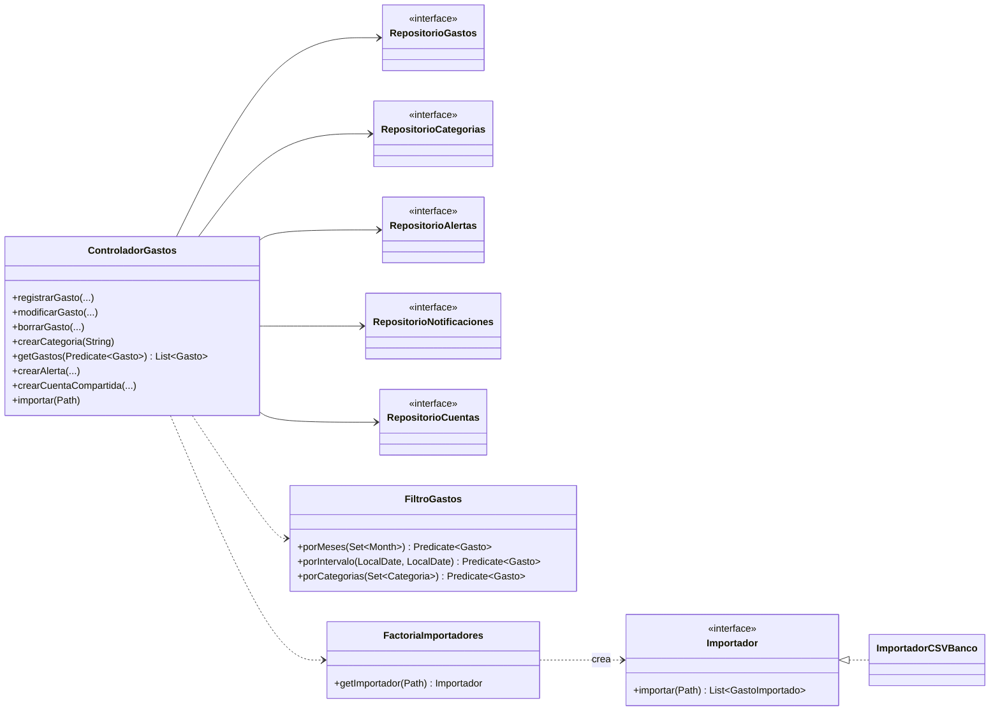

# Modelo del dominio

GitHub muestra el diagrama directamente (formato Mermaid). Como en el taller de modelado, solo aparecen los
atributos y métodos más importantes.

## Diagrama de clases

## Servicios y repositorios

No son clases del dominio, pero se incluyen para que quede claro quién usa a quién.

Cada repositorio tendrá una implementación JDBC (por ejemplo `RepositorioGastosJDBC`), y `ConfiguracionImpl`
se las pasará al controlador, igual que en el ejemplo del TPV.

## Decisiones de diseño

1. **`Categoria` es una clase y no un `enum`.** El usuario puede crear categorías nuevas. Las que vienen con la
   aplicación se marcan como `predefinida`. Dos categorías son iguales si tienen el mismo nombre, sin distinguir
   mayúsculas.
2. **Los importes son `BigDecimal`.** Con `double` aparecen errores de redondeo con dinero
   (0,1 + 0,2 ≠ 0,3).
3. **El saldo de una cuenta compartida se calcula y no se guarda.** El saldo de una persona es lo que ha pagado
   menos su parte de todos los gastos de la cuenta. Así nunca se queda desincronizado y no hay que actualizarlo
   al modificar un gasto. Además, la suma de los saldos es siempre 0.
4. **Reparto con patrón Estrategia (`PoliticaReparto`).** La cuenta no sabe cómo se reparte. Le pregunta su parte
   a la política: `RepartoEquitativo` divide entre el número de personas y `RepartoPorPorcentajes` aplica el
   porcentaje de cada una (y comprueba al crearse que suman 100). Así no hacen falta dos clases de cuenta.
5. **La lista de personas de una cuenta no se puede modificar.** Se recibe en el constructor, se guarda como
   `List.copyOf(...)` y no hay métodos para añadir ni quitar personas.
6. **Alertas con patrón Estrategia (`PeriodoAlerta`).** Lo obligatorio del enunciado. La alerta le pide al periodo
   el inicio y el fin del periodo de la fecha del gasto (lunes a domingo, o día 1 a fin de mes). Después suma con
   un *stream* los gastos de ese periodo y de su categoría, si la tiene. Para añadir, por ejemplo, un periodo
   anual basta con una clase nueva.
7. **Una notificación por alerta y periodo.** La alerta solo notifica cuando un gasto hace cruzar el límite:
   el total sin el gasto nuevo era menor o igual que el límite y con él lo supera. Así no se repite el aviso con
   cada gasto del mismo periodo (HU-16).
8. **Las notificaciones se guardan aparte de las alertas.** El historial no se pierde si se borra la alerta
   (HU-18). Para eso la notificación guarda su propio mensaje de texto.
9. **Filtros como `Predicate<Gasto>`.** Cada filtro devuelve un predicado y se combinan con `and(...)`.
   Si no hay filtros se usa `g -> true`. Encaja con el uso de lambdas y *streams* que se evalúa.
10. **Importador con patrones Adaptador y Método Factoría.** Cada formato de fichero tiene un adaptador que
    implementa `Importador` y traduce sus líneas a `GastoImportado`, un objeto intermedio con los datos tal cual
    vienen del fichero. `FactoriaImportadores` elige el adaptador según el fichero (por ejemplo, por la cabecera
    o la extensión). El controlador solo usa `Importador`, así que un formato nuevo no le afecta (RNF-4).
11. **Singleton.** `Configuracion` (ya en el esqueleto) es el único punto de acceso global. Desde ella se obtienen
    el controlador y los repositorios.

## Pendiente de decidir entre los dos

- **¿Los gastos de las cuentas compartidas cuentan en mis gráficas, filtros y alertas?** Propuesta: no. Las
  vistas y las alertas usan solo los gastos personales, y cada cuenta compartida tiene su propia vista de gastos
  y saldos.
- **¿Qué se hace al importar líneas de una cuenta compartida?** El CSV del banco tiene una columna `Account`
  (`Personal`, `Compartida 1`...) y otra `Payer`. Propuesta: las líneas de `Personal` se importan como gastos
  personales; las de una cuenta compartida se añaden a la cuenta con ese nombre si ya existe y tiene a ese
  pagador, y si no, se avisa y se saltan.
- **¿Qué se hace con la columna `Subcategory` del CSV?** En el ejemplo, `Category` es la forma de pago
  (`con tarjeta`, `efectivo`) y `Subcategory` es la categoría real (`Comida`, `Ocio`). Propuesta: usar
  `Subcategory` como categoría y meter la forma de pago en la descripción.
